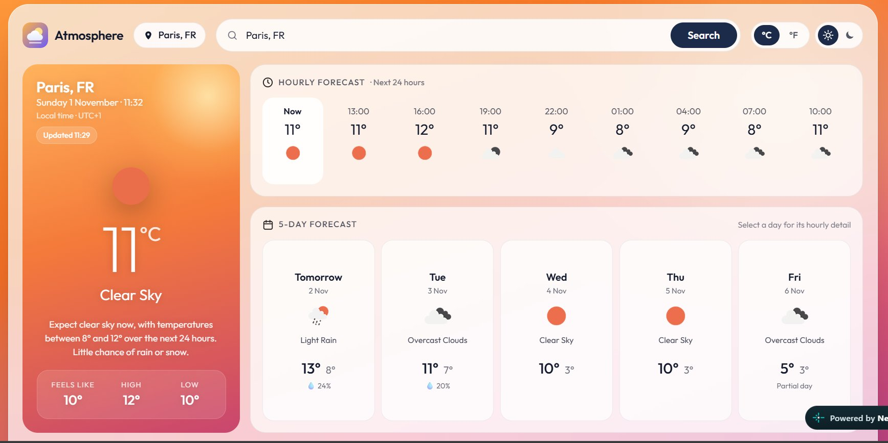
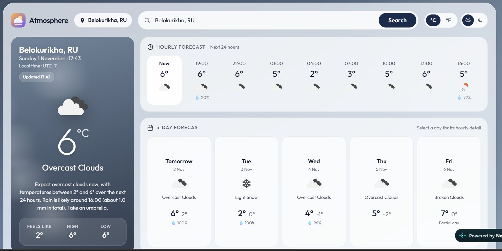
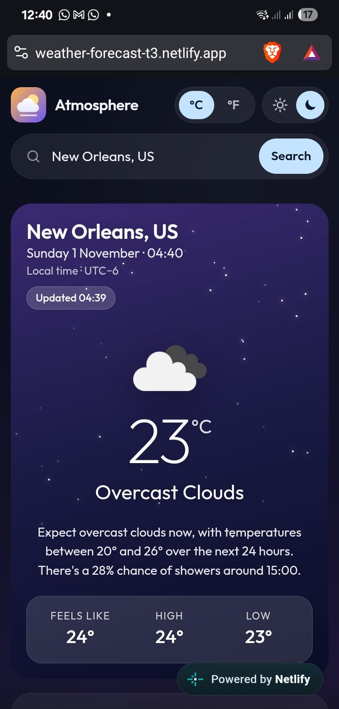

# Atmosphere: Weather & Climate Telemetry

A real-time weather dashboard built with **HTML5, CSS3 and vanilla JavaScript (ES6+)**. Search any city in the world for its live conditions and a five-day forecast. Data comes from the [OpenWeatherMap](https://openweathermap.org/) REST API.

**Live demo:** <https://weather-forecast-t3.netlify.app>

No frameworks and no build step. The browser code has no runtime dependencies. Node.js is used only for the optional dev server, the unit tests and the deployment helper.

---

## Table of contents

1. [Features](#features)
2. [Screenshots](#screenshots)
3. [Technologies](#technologies)
4. [Project structure](#project-structure)
5. [Get an OpenWeatherMap API key](#get-an-openweathermap-api-key)
6. [API configuration](#api-configuration)
7. [Local installation & running](#local-installation--running)
8. [API endpoints](#api-endpoints)
9. [Architecture](#architecture)
10. [Error handling](#error-handling)
11. [Testing](#testing)
12. [Deployment](#deployment)
13. [Known limitations](#known-limitations)

---

## Features

The layout is a dark (or light) dashboard over a sky that reacts to the weather. It draws on three reference designs: day tiles, rain-chance bars and a city list from the first; the rain-swept hero card, hourly strip and explanatory detail cards from the second; and the °C/°F toggle and tabbed "Overview" chart from the third.

**Search & preferences**
- Search any city worldwide. A country code narrows the result, e.g. `Springfield, US`.
- Submit by clicking **Search** or pressing **Enter**. **Esc** clears the field.
- Quick-search chips on the start screen. Click any card in *Other large cities* to load that city.
- Client-side validation catches empty input, input that is too short or too long, and invalid characters. None of these make an API call.
- `localStorage` remembers your **last city**, your **°C/°F choice** and your **dark/light mode**.
- The °C/°F toggle converts temperatures on screen, so switching units never makes a new request.

**Hero card (current conditions)**
- City, the city's own live **local date and time**, and its UTC offset.
- Large temperature, condition and icon, plus feels-like and the day's high and low.
- A **plain-language summary of the next 24 hours** built from the forecast. For example: "Expect light rain now, with temperatures between 9° and 14° over the next 24 hours. Rain is likely around 15:00 (about 3.2 mm in total). Take an umbrella."
- **Animated weather inside the card**: falling rain, a storm with lightning flashes, drifting snow, twinkling stars at night, a glowing sun or drifting clouds.

**Hourly forecast**: a strip that starts at "Now", then the next 24 hours in 3-hour steps, each with temperature, icon and chance of rain.

**Five-day forecast**
- The 40 three-hour slots are **grouped by calendar day in the city's own time zone**, so you see five distinct days rather than five time slots.
- Daily high = the highest `temp_max` of the day's slots. Daily low = the lowest `temp_min`.
- The icon and description show the day's most frequent daytime condition.
- **Select a day** to switch the hourly strip and the rain chart to that day. The tiles are rendered with `Array.map()`.
- A day the API only partly covers is labelled **"Partial day"**.

**Chance of rain**: a column chart of OpenWeatherMap's probability of precipitation (`pop`) for the next 24 hours or the selected day. Hover or focus a column to see the exact value and rainfall in mm.

**Today's highlights**
- Feels like, with an explanation (e.g. "Humidity is making it feel warmer").
- Humidity, with a meter and the **dew point** (Magnus formula) plus a comfort rating.
- Precipitation in the last hour and the amount expected in the next 24 hours.
- Visibility and pressure, each with a short interpretation.
- Wind on an **animated compass**, with a Beaufort description and gusts.
- Sunrise and sunset on a **sun-position arc**, with time until sunset or sunrise.

**Overview chart**: tabs for **Temperature, Humidity, Pressure and Wind** over the full five days.
- Drawn as a hand-built SVG line with a monotone curve, day separators and labels on the highest and lowest points only.
- A crosshair and tooltip follow the pointer. Keyboard users can focus the chart and step through values with ← →.
- A hidden data table gives screen readers the same values.

**Other large cities**: current conditions for four major cities, with the city you're viewing excluded. Results are cached for 10 minutes. If one city fails, only that card shows "unavailable".

**Weather themes**: six backgrounds (clear, cloudy, rain, thunderstorm, snow and night) that cross-fade smoothly. The hero card's tint cross-fades too.

**Accessibility & responsiveness**
- Semantic landmarks, a skip link, labelled controls, ARIA tabs with arrow-key support, `aria-pressed` toggles, `aria-live` announcements and visible focus rings.
- Honours `prefers-reduced-motion`; the particle animations are turned off.
- Layout: three columns on desktop, two on tablet, one on phones (down to 320 px), with no horizontal page overflow.

## Screenshots

These screenshots show live OpenWeatherMap data, taken from the deployed site.

**Light mode, clear sky (Paris).** Warm "clear" theme, hourly strip and five-day tiles.



**Light mode, overcast (Belokurikha).** Muted "clouds" theme. The forecast includes snow and a 100% chance of precipitation.



**Mobile, dark mode, night (New Orleans).** Night theme with twinkling stars and the generated 24-hour summary.



---

## Technologies

| Area | Used |
|---|---|
| Markup | Semantic HTML5 |
| Styling | CSS3 custom properties, Flexbox, Grid, `backdrop-filter`, keyframe animations, media queries |
| Logic | Vanilla JavaScript ES modules, `async`/`await`, `Promise.all` / `Promise.allSettled`, `AbortController`, `ResizeObserver`, `Intl.DateTimeFormat` |
| Charts | Hand-built SVG (line chart) and HTML/CSS (column chart) — no chart library |
| Networking | Fetch API |
| Persistence | `localStorage` |
| Data | OpenWeatherMap Current Weather + 5 Day / 3 Hour Forecast (API 2.5) |
| Tooling | Node.js ≥ 18: zero-dependency dev server, `node:test` unit tests |
| Hosting (optional) | Netlify static hosting + Netlify Function as an API-key proxy |

---

## Project structure

```
atmosphere-weather-app/
├── index.html                 # Semantic page structure and all UI states
├── css/
│   └── style.css              # Design tokens, themes, layout, animations, breakpoints
├── js/
│   ├── config.js              # API URLs, units, constants; loads the key from env.js
│   ├── api.js                 # fetch + timeout + cancellation, typed errors, response validation, city snapshots
│   ├── weather.js             # Pure data logic: day grouping, hourly slots, chart series, dew point, summary, themes
│   ├── app.js                 # DOM, events, loading/error states, every widget's rendering, preferences
│   └── env.js                 # (generated, git-ignored) holds your key locally — never committed
├── assets/
│   └── icons/                 # Logo, panel/metric icons, fallback weather icon (SVG)
├── scripts/
│   ├── dev-server.js          # `npm start` — static server that serves env.js from .env
│   ├── generate-env.js        # `npm run env` — writes js/env.js (direct or --proxy mode)
│   └── load-env.js            # Tiny .env parser shared by both scripts
├── netlify/
│   └── functions/owm.js       # Serverless proxy that adds the API key server-side
├── tests/
│   ├── weather.test.js        # Forecast grouping, themes, formatting
│   ├── widgets.test.js        # Dew point, summaries, °F, hourly slots, chart ticks, sun arc
│   └── api.test.js            # URL building, error mapping, validation
├── docs/screenshots/          # README images
├── netlify.toml               # Netlify build + functions config
├── package.json               # npm scripts (no dependencies)
├── .env.example               # Template for your local .env
├── .gitignore                 # Ignores .env and js/env.js
└── README.md
```

---

## Get an OpenWeatherMap API key

1. Create a free account at <https://home.openweathermap.org/users/sign_up> and verify your email.
2. Open **My API keys**: <https://home.openweathermap.org/api_keys>. A default key has already been created for you. Copy it.
3. **Wait for activation.** New keys can take **10 minutes to about 2 hours** to start working. Until then the API returns `401 Invalid API key`, and the app shows "API key rejected".

The free plan covers both endpoints this app uses, with **60 calls per minute and 1,000,000 calls per month**. You don't need a credit card. Each search uses **2 calls**. The *Other large cities* panel adds **up to 4 calls**, which are cached for 10 minutes and re-requested only when stale.

---

## API configuration

### Why the key isn't in `config.js`

`js/config.js` holds only public constants and is safe to commit. The key lives in a local `.env` file, which `.gitignore` excludes.

### Important: browser code cannot keep secrets

Any value that JavaScript running in the browser can read can also be read by a visitor in DevTools → Network. That includes "environment variables" baked into a static site. Keeping the key out of Git stops it **leaking through your public repository**. It does **not** hide the key from people using your deployed site.

The project therefore supports two modes:

| Mode | How it works | Use it for |
|---|---|---|
| **Direct** | The browser calls `api.openweathermap.org` with `appid=<your key>`. | Local development only. |
| **Proxy** | The browser calls `/.netlify/functions/owm`. That serverless function adds the key server-side, and the key never reaches the browser. | Any public deployment. |

`js/config.js` picks the mode automatically: proxy mode whenever `API_PROXY_URL` is set, direct mode otherwise.

### Set up your `.env`

```bash
cp .env.example .env          # Windows PowerShell:  Copy-Item .env.example .env
```

Then edit `.env`:

```dotenv
OPENWEATHER_API_KEY=paste_your_key_here
```

---

## Local installation & running

**Requirements:** a modern browser and [Node.js 18+](https://nodejs.org/) (for the dev server). Nothing needs to be installed with npm.

```bash
git clone https://github.com/FreddyDezmal/Datheon-Task-3.git
cd Datheon-Task-3
cp .env.example .env           # then add your key
npm start                      # → http://localhost:5500
```

`npm start` runs `scripts/dev-server.js`. This small static server generates `js/env.js` in memory from `.env` on every request, so no file containing the key is ever written into the project. It also refuses to serve dotfiles such as `.env` and `.git`. To use a different port, run `npm start -- 8080` or set `PORT` in `.env`.

### Using VS Code Live Server or another static server instead

ES modules don't load from `file://`, so you always need *some* local server. If you prefer a different one:

```bash
npm run env                    # writes js/env.js from .env (git-ignored)
```

Then open `index.html` with Live Server, or run `npx serve .`, `python -m http.server 5500`, and so on.

If no key is configured, the app opens on a **"Add your OpenWeatherMap API key"** screen instead of failing.

---

## API endpoints

Both calls run **in parallel** with `Promise.all()` and use `units=metric` (°C, m/s, hPa).

| Purpose | Endpoint | Key fields used |
|---|---|---|
| Current weather | `GET https://api.openweathermap.org/data/2.5/weather?q={city}&units=metric&appid={key}` | `name`, `sys.country`, `dt`, `timezone`, `main.*`, `weather[0]`, `wind.speed/deg/gust`, `visibility`, `rain/snow.1h`, `sys.sunrise/sunset` (also used for *Other large cities*) |
| 5-day / 3-hour forecast | `GET https://api.openweathermap.org/data/2.5/forecast?q={city}&units=metric&appid={key}` | `list[].dt`, `list[].main.temp/temp_min/temp_max/humidity/pressure`, `list[].wind.speed`, `list[].weather[0]`, `list[].pop`, `list[].rain/snow.3h`, `city.timezone` |
| Icons | `https://openweathermap.org/img/wn/{icon}@2x.png` (and `@4x` for the hero icon) | `weather[0].icon` |

In proxy mode the browser calls `/.netlify/functions/owm?endpoint=weather|forecast&q=…&units=metric` instead. The function accepts only those two endpoints and a fixed list of parameters, so nobody can use it as an open relay for your key.

API docs: [Current weather](https://openweathermap.org/current) · [5 day / 3 hour forecast](https://openweathermap.org/forecast5) · [Condition codes & icons](https://openweathermap.org/weather-conditions)

---

## Architecture

```
          ┌───────────────┐   submit / Enter / chip
 user ───▶│    app.js     │──────────────────────────┐
          │ DOM & events  │                          ▼
          │ loading/error │              validateCityInput()
          │ rendering     │                          │
          └──────▲────────┘                          ▼
                 │ view models          ┌──────────────────────┐
          ┌──────┴────────┐  raw JSON   │        api.js        │
          │  weather.js   │◀────────────│ fetchWeatherBundle() │── Promise.all ──▶ /weather
          │ pure functions│             │ timeout + abort      │                └▶ /forecast
          └───────────────┘             │ status → typed error │
                                        │ shape validation     │
                                        └──────────▲───────────┘
                                                   │ URLs, key, units
                                             ┌─────┴─────┐
                                             │ config.js │◀── env.js (git-ignored)
                                             └───────────┘
```

| Module | Responsibility |
|---|---|
| `config.js` | Frozen `CONFIG` object: base URLs, endpoints, units, timeouts, validation rules, storage keys. Imports the optional `env.js` with a top-level `await import()` wrapped in `try/catch`, so a missing file means "not configured" rather than a crash. |
| `api.js` | `requestJson()` wraps `fetch` with a 10 s timeout and the caller's `AbortSignal`. It maps HTTP codes to a `WeatherApiError` with a `type` and checks that the JSON contains every field the UI needs. `fetchWeatherBundle()` fetches both endpoints together. |
| `weather.js` | DOM-free and unit-tested. Covers time-zone conversion (`dt + timezone`, formatted as UTC), `groupForecastByDay()`, `summariseDay()`, `buildDailyForecast()`, `getThemeKey()`, icon URLs, compass directions, visibility and pressure descriptions. |
| `app.js` | Owns UI state (`isLoading`, `requestId`, `controller`, `current`), renders with `textContent`/`createElement` (no `innerHTML`, so API data can't inject markup), manages the live clock and persists the last city. |

**State and race conditions.** Each search:
1. aborts any in-flight request with `AbortController`,
2. takes a new incrementing `requestId`,
3. disables the button and chips while loading, and ignores Enter-key submits during that time.

A response renders only if its `requestId` is still the latest. The UI therefore can't show stale results from a slow earlier request.

**Theme selection** (`getThemeKey`) uses OpenWeatherMap condition codes, in this order: `2xx` → storm, `6xx`/`511` → snow, `3xx`/`5xx` → rain, then night (icon ends in `n`), then `800–801` → clear and everything else (`7xx` fog/haze, `802–804`) → clouds. Precipitation beats night on purpose, so a rainy night still looks rainy.

---

## Error handling

| Situation | Detected by | What the user sees |
|---|---|---|
| Empty input | client validation | "Please enter a city name to search." (no request sent) |
| Too short / long, invalid characters | client validation | Specific guidance (no request sent) |
| City doesn't exist | HTTP `404` | "We couldn't find "X". Check the spelling, or add a country code…" |
| Invalid / inactive key | HTTP `401` | "API key rejected… new keys can take a couple of hours to activate." |
| No key configured | `CONFIG.IS_CONFIGURED === false` | Setup screen + "API key not configured" |
| Rate limit | HTTP `429` | "Too many requests… wait a minute and try again." |
| Server error | HTTP `5xx` | "Weather service unavailable (HTTP 503)…" |
| Offline / DNS / blocked | `fetch` rejects (`TypeError`) | "You are offline" or "Connection problem…", plus an offline badge in the header |
| Slow API | 10 s timeout | "Request timed out" |
| Unexpected JSON | shape validation | "Unexpected response… nothing was updated." |
| Superseded search | `AbortError` | Silently ignored |

Guarantees:
- **A failed search never wipes good data.** The previous city stays on screen, and the message says "Still showing London, GB."
- **Nothing is fabricated.** If either request fails, the whole update is discarded, so the dashboard never shows one city's current weather next to another city's forecast.
- If restoring the saved city fails on page load with "not found", the app quietly shows the empty state instead of an error.
- `localStorage` access is wrapped in `try/catch`, because it throws in some private-browsing modes.
- If the icon CDN fails to load, a bundled SVG is shown instead.

---

## Testing

### Unit tests

```bash
npm test
```

19 tests using Node's built-in runner. They cover:
- time-zone-correct day grouping, five distinct days, high/low maths, the today-fallback and the dominant condition;
- every theme and the formatting helpers;
- dew point, the feels-like explanations, °F conversion, the hourly window, chart ticks, the sun arc, precipitation totals and the summary sentence;
- URL building in both modes (including a check that the key never appears in proxy URLs), HTTP-status mapping and response validation.

### Manual QA checklist

| # | Scenario | Expected |
|---|---|---|
| 1–4 | Johannesburg, London, Tokyo, New York | Correct city, local time, metrics, 5 forecast cards, theme matches conditions |
| 5 | `Atlantisxyz` | "City not found", previous data kept |
| 6 | Empty search | Validation message, no network request (check DevTools → Network) |
| 7 | DevTools → Network → **Offline**, then search | Offline message + header badge; previous data kept |
| 8 | Put a wrong key in `.env`, refresh | "API key rejected" |
| 9 | DevTools device toolbar: 320 px, 375 px, 768 px | Single column, full-width search, forecast scrolls sideways, no page overflow |
| 10 | Search cities with different weather | Background cross-fades to the matching theme |
| 11 | Inspect forecast cards | Five different dates |
| 12 | `git status` / `git ls-files` | `.env` and `js/env.js` are **not** listed |

These scenarios were also automated with Playwright in headless Chromium against mocked API responses, together with checks for every widget: day selection, tabs, tooltips, the °F toggle, light mode and city cards (47/47 checks passed). The app has since been run against the live API on the Netlify deployment; see [Screenshots](#screenshots).

---

## Deployment

### 1. Push to GitHub (without your key)

```bash
git status                    # .env and js/env.js must NOT appear
git add .
git commit -m "Build Atmosphere weather dashboard"
git push origin main
```

Before every push, run `git ls-files | grep -E "(^|/)\.env$|env\.js$"`. It should print nothing.

If you ever commit a key by accident, **regenerate it** in the OpenWeatherMap dashboard straight away. Removing it from Git history alone is not enough, because the old key has already been exposed.

### 2. Production hosting: Netlify (recommended, keeps the key private)

1. On [Netlify](https://app.netlify.com/), choose **Add new site → Import an existing project** and pick this GitHub repository.
2. Build settings come from `netlify.toml`, so leave them as they are:
   - Build command: `node scripts/generate-env.js --proxy` (writes an `env.js` that contains **no key**, only the proxy URL)
   - Publish directory: `.`
   - Functions directory: `netlify/functions`
3. Under **Site configuration → Environment variables**, add `OPENWEATHER_API_KEY` = your key.
4. Deploy. The browser now calls `/.netlify/functions/owm`, and the function calls OpenWeatherMap with the key from the server environment. Successful responses are cached for 5 minutes to protect your rate limit.

To try the proxy locally, install the [Netlify CLI](https://docs.netlify.com/cli/get-started/) and run `netlify dev`.

**Other platforms.** The proxy is about 60 lines and uses only the standard `Request`/`Response`/`fetch` APIs. It ports easily to a Vercel Function, Cloudflare Worker or a small Express route. Point `API_PROXY_URL` at the new path.

### 3. GitHub Pages (static only)

GitHub Pages can't run server code, so it can host the site only in **direct mode**. That means the key would ship to every visitor's browser. If you still want to use Pages for a demo:
- Create a **separate** free key used only for the demo.
- Generate `js/env.js` in a GitHub Actions workflow from a repository secret. Never commit it.
- Accept that people can read the key in DevTools, and rotate it if it gets abused.

For a portfolio link, use Netlify (above) and keep GitHub for the source code.

---

## Known limitations

- **The last forecast day is usually partial.** The free forecast covers about 120 hours from the next 3-hour slot. The fifth day therefore often has only a few slots, so its high/low may understate the true daily range. The card is labelled "Partial day" in that case.
- **City-name search is ambiguous for duplicate names.** "Springfield" returns OpenWeatherMap's best match. Add a country code (`Springfield, US`) or a state (`Springfield, IL, US`) to narrow it.
- **"Updated" time** is the observation time OpenWeatherMap reports (`dt`), which can be 10–60 minutes old on the free plan.
- **Elements from the reference designs that were left out on purpose:**
  - a global weather map, which needs a map library and tile service;
  - a UV index and a 10-day forecast, which need the paid One Call API 3.0;
  - a newsletter "Subscribe" card and user avatar/navigation, which would have no real feature behind them.
- **The Chance of rain chart** plots OpenWeatherMap's `pop`, which is the probability of *any* precipitation, snow included.

---

Weather data © [OpenWeatherMap](https://openweathermap.org/), licensed under [CC BY-SA 4.0](https://creativecommons.org/licenses/by-sa/4.0/).
